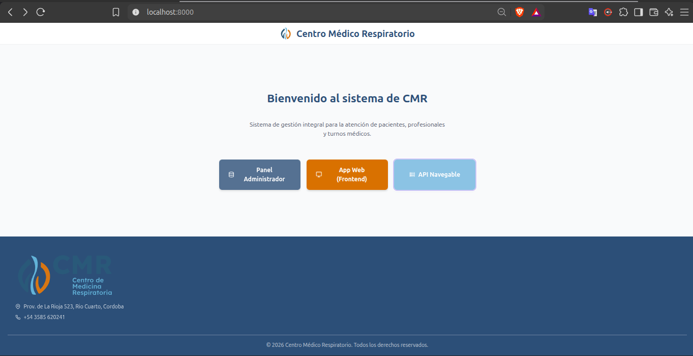
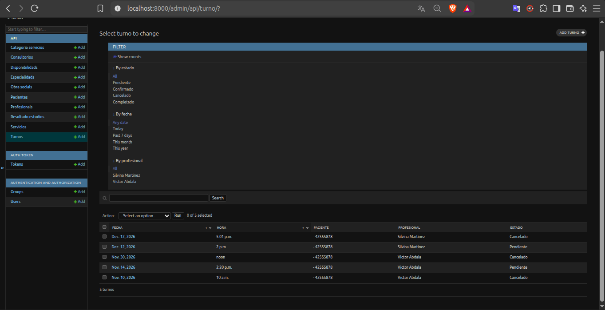
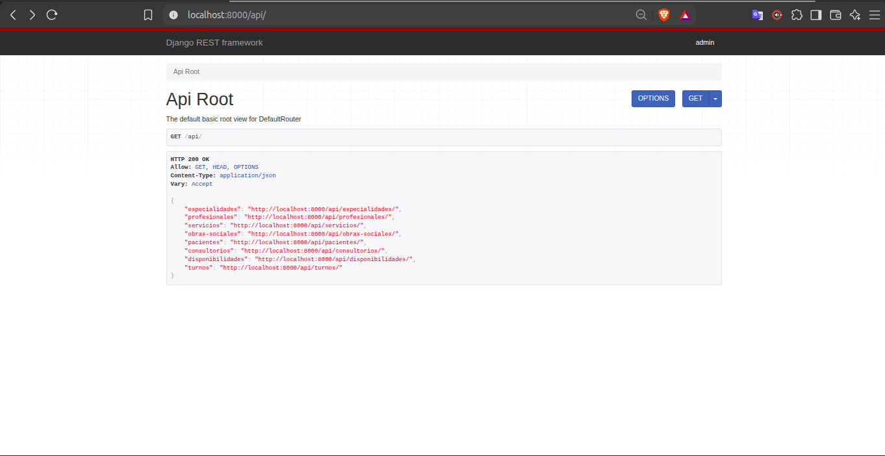
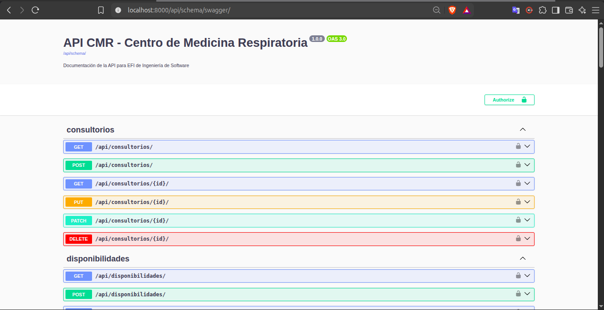
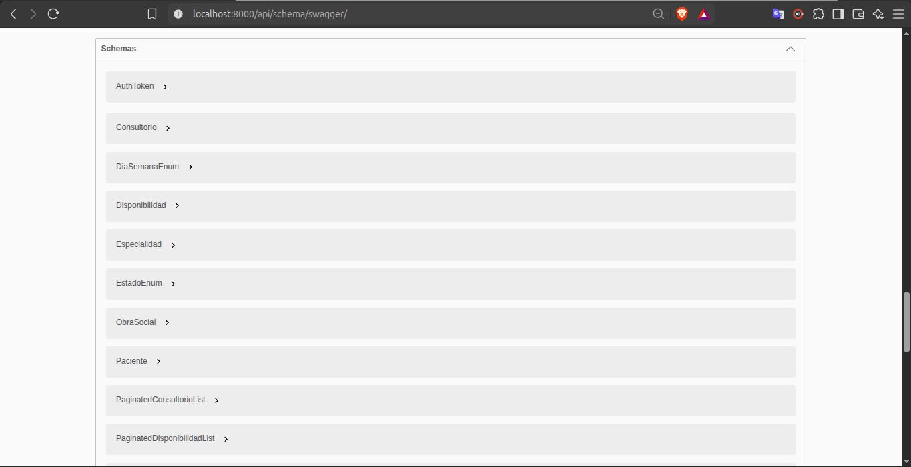
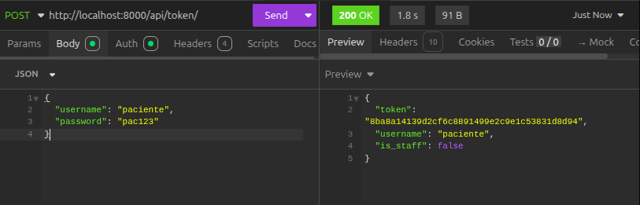
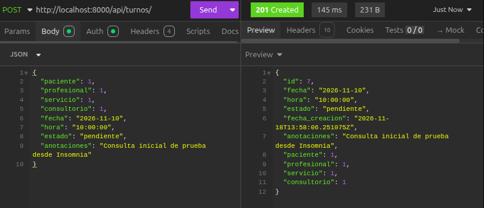
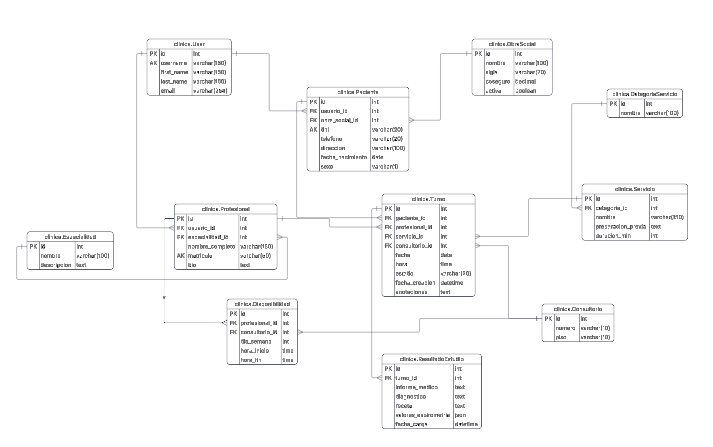

# CMR - Centro Médico Respiratorio (Backend API)

API RESTful desarrollada con Django y Django REST Framework para la gestión integral de pacientes, profesionales y turnos médicos del Centro Médico Respiratorio (CMR). 

Este proyecto corresponde a la **Evaluación Final Integradora (EFI)** de la cátedra Ingeniería de Software - Tecnicatura Superior en Desarrollo de Software (ITEC Río Cuarto).

## 🚀 Tecnologías Utilizadas

* **Framework:** Django 5.1 + Django REST Framework (DRF)
* **Base de Datos:** SQLite3
* **Autenticación:** DRF Token Authentication (Token estático)
* **Gestor de Paquetes y Entorno:** `uv`
* **Contenedores:** Docker & Docker Compose
* **Documentación API:** drf-spectacular (Swagger UI / ReDoc)
* **CORS:** Configurado para consumo desde frontend en Next.js (Localhost y Producción).

## 📋 Requisitos Cumplidos (EFI)

- [x] Desarrollo de 10 modelos relacionados al dominio del problema.
- [x] Habilitación de 8 ViewSets con operaciones CRUD y de lectura.
- [x] Implementación de `NestedSerializers` exclusivos para los métodos GET (list).
- [x] Paginación global y filtros/búsquedas aplicados en endpoints principales (Turnos).
- [x] Endpoints protegidos mediante Autenticación por Sesión y por Token.
- [x] Implementación de 2 funciones personalizadas con el decorador `@action` (`/cancelar/` y `/proximos/`).
- [x] Documentación automática con Swagger y ReDoc.
- [x] Vista principal (Template HTML) renderizada en la raíz del proyecto.
- [x] Entorno virtual gestionado con `uv` y proyecto 100% dockerizado.

## ⚙️ Instalación y Ejecución Local (Docker)

El proyecto está dockerizado para garantizar un entorno reproducible sin necesidad de instalar Python o dependencias locales, utilizando una imagen ligera y el gestor `uv`.

1. **Clonar el repositorio:**
   ```bash
   git clone [https://github.com/RoyScc/cmr-backend.git](https://github.com/RoyScc/cmr-backend.git)
   cd cmr-backend

2. **Construir y levantar el contenedor:**

Bash
sudo docker compose up --build

3. **Aplicar las migraciones de la base de datos (en una nueva terminal):**

Bash
sudo docker compose exec backend python manage.py migrate

4. **Crear un superusuario (para acceder al panel de administración):**

Bash
sudo docker compose exec backend python manage.py createsuperuser

## 🔐 Autenticación y Uso de la API
Toda la API (excepto la documentación y el panel admin) está protegida. Para acceder a los endpoints debes obtener un token de acceso, ingresando las credenciales correspondientes del usuario.

## 📚 Documentación de Endpoints
El esquema completo de la API puede visualizarse y probarse interactivamente en:

Swagger UI: http://localhost:8000/api/schema/swagger/

ReDoc: http://localhost:8000/api/schema/redoc/

## Capturas de pantalla 










## 🗄️ Diagrama de Base de Datos



## 👨‍💻 Autor
Roy Scheurer - GitHub
